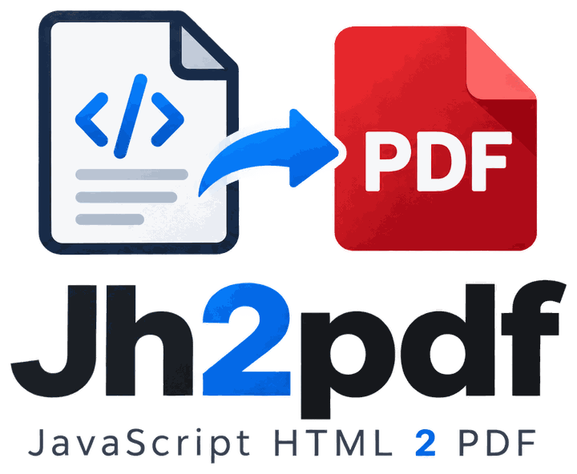

<p align="center"></p>

# Jh2Pdf

[English](README.md) · [Português](README.pt-BR.md) · **Español**

**HTML a PDF idéntico al navegador, sin navegador en el servidor.** Sin Chrome headless, sin Puppeteer, sin wkhtmltopdf. Funciona en hosting compartido (solo PHP + GD).

📖 **[Documentación completa](docs/es.html)** · 🎨 **[Galería de ejemplos](demo/es.html)** (tablas, degradados, sombras, imágenes con filtros, listas, una factura) · 📄 [Licencia MIT](LICENSE)

## Por qué existe

Generar PDF a partir de HTML suele terminar en uno de estos callejones sin salida:

| Opción | Problema |
| --- | --- |
| Chrome/Puppeteer en el servidor | necesita un VPS/contenedor; no funciona en hosting compartido |
| wkhtmltopdf | binario en el servidor, CSS antiguo, proyecto abandonado |
| Dompdf / mPDF / TCPDF leyendo el HTML | solo entienden CSS 2.1: sin flexbox, grid, variables CSS, `clamp()`, filtros… el PDF sale distinto de la pantalla |
| API externa de PDF | costo, dependencia de terceros y el contenido sale de tu servidor |

La idea: **el navegador de quien exporta ya es el mejor motor de diseño que existe, y ya está abierto**. En lugar de reimplementar CSS en PHP, el
navegador calcula dónde va cada palabra, caja, borde e imagen; PHP solo dibuja esas posiciones en un PDF. No hay saltos de línea ni cálculo de
diseño en el servidor que puedan fallar.

## Cómo funciona

```
 NAVEGADOR (JS)                                         SERVIDOR (PHP)
 ──────────────                                         ──────────────
 tu HTML + tu CSS                                       Options  (tempDir, fontDir, imageResolver…)
   │ dibuja fuera de pantalla (fuentes e imágenes listas)  │
   ▼                                                       ▼
 extractLayout()  recorre el DOM:                       Layout::clean()   valida todo (no confía en el JSON)
   getComputedStyle + Range.getClientRects por palabra     │
   │                                                       ▼
   ▼                                                    Renderer::render()   Dompdf\Cpdf
 JSON de operaciones de dibujo ── POST ──────────────►    R rectángulo · B bordes · T texto · I imagen
 { w, h, pages:[{ bg, ops:[…] }] }                         M marca a mano · L línea · C/E recorte redondeado
                                                           │
                                                           ▼
                                                        bytes del PDF  (texto seleccionable, fuentes incrustadas)
```

Lo que el navegador mide y PHP solo reproduce: la posición y el tamaño de **cada palabra** (ancho exacto, línea base), fondos, bordes por lado,
esquinas redondeadas, `overflow: hidden` con esquinas (recorte), imágenes con `object-fit`, filtros (`grayscale`, `sepia`, `blur`, `saturate`,
`hue-rotate`…), `drop-shadow`, viñetas de lista, opacidad, `text-transform`, `letter-spacing`, subrayado/tachado.

## Requisitos

- **Navegador:** cualquiera moderno (Chromium, Firefox, Safari). El diseño que calcula es el del PDF.
- **Servidor:** PHP ≥ 8.1, extensiones `gd` y `mbstring`, y [`dompdf/dompdf`](https://github.com/dompdf/dompdf) ^3.1.
- Fuentes: TTF **estáticos** (ver [Fuentes](#fuentes)). Se incluyen 12 familias libres (OFL) listas en `fonts/`.

## Inicio rápido

**1. Navegador:** copia `js/jh2pdf.js` a tu sitio y:

```js
import { extractLayout } from './jh2pdf.js';

const layout = await extractLayout(
  ['<h1>Hola</h1><p>Primera página</p>', '<p>Segunda página</p>'],  // un fragmento de HTML por página
  { width: 1280, height: 720 }                                      // tamaño de la página en px CSS
);
const res = await fetch('/pdf.php', { method: 'POST', headers: { 'Content-Type': 'application/json' }, body: JSON.stringify(layout) });
const pdf = await res.blob();                                       // application/pdf
```

El CSS de tu página ya se aplica: el módulo dibuja cada página en un contenedor fuera de la pantalla, dentro de tu propio documento.

**2. Servidor:** `composer require dompdf/dompdf` y:

```php
require 'Jh2Pdf/autoload.php';       // o: composer require jh2pdf/jh2pdf

$layout = json_decode(file_get_contents('php://input'), true);

$options = new Jh2Pdf\Options('/ruta/con/escritura');    // carpeta temporal (caché de fuentes + imágenes temporales)
$pdf = (new Jh2Pdf\Renderer($options))->render($layout, 'Título del documento');

header('Content-Type: application/pdf');
echo $pdf;
```

Hay un ejemplo completo y ejecutable en [`examples/minimal/`](examples/minimal/).

**Galería de ejemplos** (7 páginas A4 con tablas, degradados, sombras, imágenes con filtros, listas y una factura):

```bash
composer install
php -S localhost:8080
```

Abre `http://localhost:8080/demo/` y haz clic en **Gerar PDF** (Generar PDF) para comparar la vista previa con el PDF. En XAMPP, basta con abrir `http://localhost/jh2pdf/demo/`.

## API

### JavaScript: `extractLayout(pages, options)`

| Opción | Tipo | Descripción |
| --- | --- | --- |
| `width`, `height` | número (px) | **obligatorios.** Tamaño de la página en px CSS (1280×720 = 16:9; en el PDF se convierte en 960×540 pt) |
| `wrap(page, i)` | función → string | HTML **completo** de la página (un único elemento raíz; su `background-color` se convierte en el fondo de la página). Por defecto: `<div>` + el HTML de la página + `</div>` |
| `hostCss` | string | CSS extra dentro del contenedor de medición (p. ej., un reset de `box-sizing`/`margin` que tu CSS espere). Limítalo con `[data-jh2pdf-host]` |
| `skip(el)` | función → bool | `true` para **no** dibujar un elemento (ni su contenido) |
| `acceptImage(src)` | función → bool | filtra los `src` de imagen que se envían (quien decide de verdad es el servidor) |
| `marks` | bool | dibuja las marcas a mano (`.mk` + `.mk-circle`…; ver [Marcas a mano](#marcas-a-mano)) |
| `sanitize(html)` | función → string | sanitizador del HTML de cada página (p. ej., DOMPurify); el módulo igual elimina scripts, `on*=` etc. encima. Ver [Seguridad](#seguridad) |

Devuelve `{ w, h, pages: [{ bg, ops }] }`. Espera las fuentes (`document.fonts.ready`) y las imágenes (hasta 4 s cada una) antes de medir.

### PHP

| Clase | Función |
| --- | --- |
| `Jh2Pdf\Options` | configuración: `tempDir` (**obligatorio**, con escritura), `fontDir`, `imageResolver`, `marksCss`, `creator`, `fallbackFont`, límites (`maxPages`, `maxOpsPerPage`, `maxOpsTotal`, `maxImages`), `memoryLimit`, `pxToPt` |
| `Jh2Pdf\Renderer` | `render(array $layout, string $title = ''): string` devuelve los bytes del PDF; lanza `Jh2Pdf\Exception` |
| `Jh2Pdf\ImageResolver` | interfaz `load(string $src): ?string`: **tú decides** de dónde vienen las imágenes |
| `Jh2Pdf\DataUriImageResolver` | resolvedor por defecto: solo `data:image/...;base64,...` |
| `Jh2Pdf\Layout` | `clean()` valida el JSON; `num()`/`color()` son conversores seguros |
| `Jh2Pdf\ImageFilter` | filtros de imagen de CSS con GD (se puede usar por separado) |
| `Jh2Pdf\Fonts`, `Images`, `Marks`, `Svg` | internos: fuentes por peso, imágenes/sombras, marcas, trazados SVG |

### Imágenes

El `src` de cada imagen viene del navegador y **no es confiable**. Por defecto solo se acepta `data:` (nada de disco ni de red). Para servir imágenes
de tu sistema, implementa el resolvedor validando lo que el usuario puede ver:

```php
final class MiResolvedor implements Jh2Pdf\ImageResolver
{
    public function load(string $src): ?string
    {
        if (!preg_match('~^/uploads/([a-f0-9]{16}\.(png|jpg))$~', $src, $m)) return null;   // solo tu patrón
        $f = '/var/app/uploads/' . $m[1];
        return is_file($f) ? file_get_contents($f) : null;
    }
}
$options->imageResolver = new MiResolvedor();
```

En el navegador, `acceptImage` evita enviar lo que el servidor rechazaría.

## Fuentes

Dompdf no lee woff2 ni fuentes variables, y el navegador usa las variables. Por eso `fonts/` contiene **TTF estáticos**, uno por peso:

```
fonts/dm-sans-400.ttf  dm-sans-500.ttf  dm-sans-600.ttf  dm-sans-700.ttf  dm-sans-400-italic.ttf …
        └ familia (minúsculas, guiones) └ peso 400/500/600/700           └ cursiva, si la familia la tiene
```

- El navegador informa la **familia y el peso exactos** de cada palabra; PHP usa el archivo de ese peso. Si no existe, usa la fuente de reserva (DejaVu).
- Familias sin cursiva (p. ej., JetBrains Mono): el PDF inclina la normal 12°, como hace el navegador.
- **Agregar una fuente:** `pip install fonttools brotli` y `python tools/generate-fonts.py --fonts fonts.json --src carpeta-de-fuentes --out fonts`
  (ver la cabecera del script para el formato de `fonts.json`). El servidor no necesita Python.

Incluidas (SIL Open Font License 1.1): Barlow Condensed, DM Sans, Fira Code, Inter, JetBrains Mono, Montserrat, Nunito, Open Sans y cuatro serif renombradas:
**Jh Serif** (de Lora), **Jh Serif Text** (de Merriweather), **Jh Display** (de Playfair Display) y **Jh Serif Book** (de Source Serif 4).

## Marcas a mano

Extensión **opcional** (desactivada por defecto; no es HTML/CSS estándar) para resaltar texto con un dibujo hecho a mano (círculo, subrayado, resaltado, caja, tachado, X):

```html
<span class="mk mk-circle" style="--mk-color:#e5484d">importante</span>
```

Con `marks: true`, el extractor envía la posición del texto marcado y el color (`--mk-color`); PHP dibuja el SVG de la forma (`resources/marks.css`, o tu propio CSS
mediante `Options::$marksCss`). Sin `--mk-color`, se usa el color del texto. La 2.ª variante de cada forma se aplica a los elementos pares (`:nth-of-type(even)`);
una marca con `display: inline` que se parte en varias líneas recibe un dibujo por línea. Sin `marks: true`, las clases `.mk` se tratan como cualquier otro elemento.

## Seguridad

Hay dos fronteras. En cada una, lo que viene del otro lado se trata como **hostil**.

### Servidor: el JSON del navegador

Cualquiera que pueda llamar a tu endpoint puede enviar un JSON hecho a mano. Por diseño, el servidor **nunca interpreta HTML, CSS ni JavaScript**:
solo dibuja números, colores y texto. Eso elimina la clase de ataque más peligrosa de los generadores de PDF a partir de HTML (el parser de HTML/CSS de Dompdf/mPDF,
`@font-face`, `<link>`, `file://`, SSRF): aquí Dompdf se usa solo como lienzo de PDF.

| Ataque | Defensa |
| --- | --- |
| Inyectar HTML/JS/CSS en el texto | el texto es solo texto: va al PDF como glifos (hexadecimal) y nunca se interpreta |
| Inyectar operadores/objetos PDF (`) Tj (…`, `/OpenAction`, `/JS`, `/URI`, `/Launch`) | texto en hexadecimal; título escapado y sin caracteres de control; no se crea ningún objeto de acción/anotación. Una prueba busca esos nombres en el PDF y en los streams descomprimidos |
| Nombre de fuente con `../`, `)`, byte nulo | reducido a `[A-Za-z0-9 -]` (60 caracteres) y asignado solo a archivos de `fonts/` |
| Leer archivos locales o hacer peticiones (`file://`, `http://`, `../`) | imágenes solo mediante el `ImageResolver`; el predeterminado acepta **solo** `data:image/(png\|jpeg\|gif\|webp)`. En Dompdf están desactivados `isRemoteEnabled`, PHP y JS |
| Bomba de imagen (PNG de 17 KB que declara 144 millones de píxeles) | la cabecera se lee **antes** de decodificar: tipo permitido, lado ≤ 20 000 px, ≤ 25 megapíxeles; ancho de trabajo ≤ 4000 px |
| Agotar CPU/memoria con millones de operaciones | `maxPages` (1000), `maxOpsPerPage` (60 000), `maxOpsTotal` (400 000), `maxImages` (200), recortes anidados ≤ 32, sombras/desenfoques con tope, `set_time_limit(180)` |
| Números/tipos absurdos (`1e999`, `NaN`, un array en lugar de un número, color `url(...)`) | todo pasa por `Layout::num()` (intervalo fijo) y `Layout::color()` (solo `#rgb`/`#rrggbb`) |
| Filtración de rutas del servidor en mensajes de error | `Renderer::render` solo lanza `Jh2Pdf\Exception` con un mensaje genérico; el detalle está en la excepción anterior (`getPrevious()`, para tu log) |
| Archivos temporales olvidados | nombres aleatorios solo dentro de `tempDir`, borrados al final de cada PDF y (si el proceso murió) barridos después de 1 hora |

**Lo que la biblioteca no hace (queda a tu cargo):** autenticación, CSRF, límite de peticiones y **límite del tamaño del cuerpo** de la petición (generar PDF es costoso; `examples/` muestra
un límite de 5 MB), y el `ImageResolver`: si devuelve archivos, verifica que **ese usuario** pueda ver **ese** archivo (nunca concatenes el `src` en una ruta).
Mantén `dompdf/dompdf` y PHP/GD actualizados: la decodificación de imágenes (GD) es donde más aparecen errores de terceros.

### Navegador: el HTML de entrada

El extractor coloca el HTML de cada página en el DOM de **quien está exportando** para que el navegador lo mida. Si ese HTML viene de otra persona, es una entrada hostil
contra **el navegador de quien exporta** (XSS clásico: ``). Defensas:

- el HTML se coloca primero en un `<template>` (inerte: nada se ejecuta, nada se carga), donde se eliminan `script`, `iframe`, `object`, `embed`, `link`, `meta`, `base`,
  atributos `on*`, `srcdoc`, URLs `javascript:`/`vbscript:`/`data:` que no sean imagen y estilos con `expression()`; solo entonces el contenido va a la página.
  Probado: ``, `<script>`, `<a href="javascript:">`, `<svg onload>`, `<iframe srcdoc>`, `onclick`, `data:text/html`: nada se ejecuta;
- es un **filtro de respaldo**. Si el contenido es de terceros, sanitízalo con un sanitizador de verdad y pásalo en `sanitize`
  (`extractLayout(pages, { sanitize: (h) => DOMPurify.sanitize(h) })`); el filtro de la biblioteca igual se ejecuta encima;
- `<style>` y `url()` en el CSS siguen permitidos (el CSS no ejecuta código, pero puede **pedir** una URL, es decir, rastrear). Si eso importa, fíltralo en `sanitize`.

## Lo que (todavía) no se dibuja

Funciona bien para documentos, informes, tablas y diapositivas (ver la [galería](demo/es.html)). Hoy **no** salen iguales en el PDF:

- `box-shadow` con desenfoque (sin desenfoque, interior o exterior, sí se dibuja), `text-shadow`, `background-image: url()`, `transform`, `clip-path`, SVG/`<canvas>` en línea;
- `linear-gradient` sale vertical u horizontal (los diagonales se ajustan a la dirección más cercana); `radial-gradient` y los degradados repetidos o en capas, no;
- los bordes `dashed`/`dotted`/`double` salen sólidos; el subrayado y el tachado se dibujan palabra por palabra (no pasan bajo los espacios);
- ligaduras tipográficas (p. ej., `=>` en JetBrains Mono se convierte en dos caracteres);
- pseudoelementos con texto o contadores, `::first-letter`, `<video>`, `<iframe>`. Los pseudoelementos que son solo una **caja vacía** (`content: ''` con fondo, borde, esquinas redondeadas o `box-shadow` sin desenfoque) **sí se dibujan** cuando son `position: absolute` o `display: block`;
- pesos fuera de 400–700 (se redondean al más cercano);
- paginación automática: cada elemento de `pages` es una página; lo que exceda la altura se corta.

Son buenas contribuciones: cada una se convierte en una operación nueva en el JSON (ver [Cómo contribuir](#cómo-contribuir)). La tabla completa está en [docs › CSS soportado](docs/es.html#css).

## Estructura

```
jh2pdf/
├── LICENSE               MIT
├── assets/               logo, icono y favicon (logo-original.png es el original)
├── README.md             en inglés + README.pt-BR.md y README.es.md (este)
├── composer.json         paquete Composer (autoload PSR-4: Jh2Pdf\ → src/)
├── autoload.php          autoloader para quien no usa Composer
├── src/                  PHP: Renderer, Layout, Options, ImageResolver, Images, ImageFilter, Fonts, Marks, Svg
├── js/jh2pdf.js          extractor de diseño (módulo ES, sin dependencias)
├── fonts/                TTF estáticos (OFL)
├── resources/marks.css   dibujos SVG de las marcas a mano
├── docs/                 documentación completa: index.html (en), pt-BR.html, es.html
├── docs/format.md        formato de las operaciones (el "contrato" entre JS y PHP)
├── demo/                 galería de ejemplos (abre demo/index.html a través de un servidor PHP)
├── examples/minimal/     ejemplo mínimo (HTML + endpoint PHP)
├── tools/generate-fonts.py   genera los TTF a partir de fuentes variables
└── tests/run.php         pruebas (php tests/run.php o composer test)
```

## Cómo contribuir

- **Pruebas:** `php tests/run.php` (necesita Dompdf: `composer install` aquí, o el `vendor/` del proyecto que aloja la carpeta). No hay framework de pruebas.
- **Comparar con el navegador:** el criterio de calidad es *quedar igual que la pantalla*. Genera el PDF desde el navegador (Imprimir → Guardar como PDF) y con esta biblioteca y
  compáralos lado a lado, ampliando (p. ej., PyMuPDF `page.get_pixmap(dpi=200)`).
- **Nueva operación** (p. ej., degradado radial): (1) el extractor en `js/jh2pdf.js` emite `{t:'G',…}`; (2) `Layout::OPS` recibe la letra;
  (3) `Renderer::render` recibe el `case`; (4) documéntala en `docs/format.md`; (5) pruébala en `tests/run.php`. Valida **cada** campo nuevo (es una entrada hostil).
- **Estilo:** PHP 8.1, `declare(strict_types=1)`, sin dependencias aparte de Dompdf; JS sin dependencias, nombres de nivel superior con el prefijo `pl`.
- Si tienes dudas, abre un *issue* describiendo el HTML/CSS que sale distinto y adjunta el PDF del navegador.

## Licencia y créditos

- **Código:** [licencia MIT](LICENSE), © 2026 Geison Quevedo. Úsalo, modifícalo y véndelo libremente, incluso en proyectos cerrados, manteniendo el aviso de copyright y el texto de la licencia.
- **Dompdf** (LGPL-2.1) y sus dependencias (php-font-lib LGPL-2.1+, php-svg-lib LGPL-3.0+, masterminds/html5 MIT, php-css-parser MIT) se instalan con Composer y se usan como biblioteca, sin modificaciones. Detalles en [docs › Dependencias](docs/es.html#dependencies).
- **Fuentes** en `fonts/`: SIL Open Font License 1.1 (© de sus respectivos autores; instancias estáticas generadas a partir de las fuentes variables originales).
  Avisos y texto de la licencia en `fonts/OFL.txt`. Lora, Merriweather, Playfair Display y Source Serif 4 tienen nombre reservado (RFN), por eso sus instancias
  estáticas vienen renombradas como Jh Serif, Jh Serif Text, Jh Display y Jh Serif Book. Si generas instancias nuevas de fuentes con RFN, renómbralas también.
